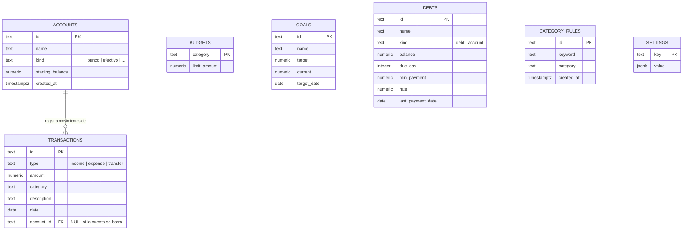

# Cuentas Claras

Sistema local de gestión financiera personal: ingresos, gastos, cuentas,
presupuestos, metas de ahorro, deudas y análisis.

Corre enteramente en esta PC. No usa ningún servicio en la nube: el backend es
una API en **FastAPI** (Python) y los datos se guardan en un PostgreSQL que
corre en esta misma máquina. Sin internet funciona igual (salvo la
tipografía, que se descarga de Google Fonts si hay conexión; si no, usa una
tipografía del sistema).

## Stack tecnológico

| Capa            | Tecnología                                              |
|------------------|----------------------------------------------------------|
| Backend          | Python 3.10+, FastAPI, Uvicorn                           |
| Acceso a datos   | asyncpg (driver asíncrono de PostgreSQL, sin ORM)         |
| Base de datos    | PostgreSQL (local)                                       |
| Validación       | Pydantic (modelos de request/response)                   |
| Frontend         | HTML + CSS + JavaScript estático, sin build (servido por FastAPI) |
| Importación PDF  | pdfplumber (extractos de tarjeta Nu Colombia)             |

## Arquitectura

```
Navegador (public/*.html, app.js)
        │  fetch /api/*
        ▼
FastAPI (app/main.py)
        │  incluye routers por dominio
        ▼
app/routers/*.py  →  app/db.py (pool asyncpg)  →  PostgreSQL (cuentas_claras)
```

- `app/main.py` arma la app, registra los routers bajo `/api` y al final monta
  `public/` como archivos estáticos (por eso las rutas de la API se declaran
  **antes** del `StaticFiles`, si no el mount se comería todo).
- Cada router (`transactions`, `accounts`, `budgets`, `goals`, `debts`,
  `category_rules`, `settings`, `imports`, `exports`) expone únicamente los
  endpoints de su propio dominio y usa `app/schemas.py` para validar entrada y
  salida con Pydantic.
- `app/db.py` concentra todo el acceso a datos: pool de conexiones, el DDL del
  esquema (`SCHEMA_SQL`), migraciones idempotentes y el seed de datos de
  ejemplo. No hay ORM: las consultas son SQL directo con `asyncpg`.
- No hay estado en el servidor entre requests: cada request abre una conexión
  del pool, hace su trabajo y la devuelve.

## Modelo entidad-relación



Notas sobre el modelo:

- **`accounts` → `transactions`** es la única relación con clave foránea real
  (`transactions.account_id REFERENCES accounts(id) ON DELETE SET NULL`): si
  se borra una cuenta, sus movimientos no se borran, quedan sin cuenta
  asignada. Una cuenta puede tener cero, uno o muchos movimientos.
- `budgets`, `goals`, `debts` y `category_rules` son tablas independientes,
  sin clave foránea hacia `transactions`: se vinculan por **convención de
  texto**, no por integridad referencial:
  - `budgets.category` y `category_rules.category` deben coincidir con el
    string usado en `transactions.category` (la lista de categorías válidas
    vive en `settings`, no en una tabla propia).
  - `debts` modela tanto deudas como cuentas externas a efectos de
    seguimiento manual de saldo (columna `kind`); no se cruza automáticamente
    con `transactions`.
- `settings` es una tabla de tipo *key-value* (una sola fila con `key='app'`)
  que guarda moneda, categorías de ingreso/gasto y el flag `isExample`. Se
  eligió así, en vez de columnas fijas, porque ese documento crece con
  facilidad (nuevas categorías) sin requerir migraciones de esquema.
- El campo `transactions.type` incluye `'transfer'` además de `income` y
  `expense`: representa movimientos entre cuentas propias (p. ej. pagar la
  tarjeta desde la cuenta corriente). Se excluye de los cálculos de
  ingresos/gastos y de las categorías para no duplicar el efecto de una misma
  plata en el análisis financiero, pero sí se refleja en el saldo de las
  cuentas involucradas.

## Requisitos

- Python 3.10 o superior. Ya lo tenés instalado.
- PostgreSQL corriendo localmente (ya lo tenés instalado y como servicio,
  `postgresql-x64-18`).

## Configuración inicial (una sola vez)

1. Editá el archivo `.env` de esta carpeta y completá `PGPASSWORD` con la
   contraseña de tu usuario `postgres` (la que definiste al instalar
   PostgreSQL). El resto de los valores (`PGUSER=postgres`,
   `PGDATABASE=cuentas_claras`) ya están puestos.

2. Creá el entorno virtual e instalá las dependencias (una sola vez):

   ```
   python -m venv .venv
   .venv\Scripts\pip install -r requirements.txt
   ```

No hace falta crear ningún usuario ni base a mano: el servidor crea la base
`cuentas_claras` sola la primera vez que arranca, usando tu usuario
`postgres`.

El archivo `.env` no se comparte ni se sube a ningún lado — queda solo en tu
disco (está en `.gitignore`). Hay un `.env.example` de referencia por si
necesitás recrearlo.

## Cómo usarlo (cada vez)

1. Verificá que el servicio de PostgreSQL esté corriendo (normalmente arranca
   solo con Windows; si no, iniciá el servicio `postgresql-x64-18` desde
   "Servicios").
2. Abrí una terminal en esta carpeta (`Escritorio\Finanzas`) y ejecutá:

   ```
   .venv\Scripts\python run.py
   ```

3. Se abre solo el navegador en `http://localhost:4500`. Si no se abre solo,
   entrá manualmente a esa dirección.
4. Para detener el servidor, volvé a la terminal y presioná `Ctrl+C`.

La documentación interactiva de la API (generada automáticamente por
FastAPI) queda disponible en `http://localhost:4500/docs`.

## Dónde están tus datos

En la base `cuentas_claras` de tu PostgreSQL local (no en un archivo suelto).

- **Backup**: `"C:\Program Files\PostgreSQL\18\bin\pg_dump.exe" -U postgres -h localhost cuentas_claras > backup.sql`
- **Restaurar**: `"C:\Program Files\PostgreSQL\18\bin\psql.exe" -U postgres -h localhost cuentas_claras < backup.sql`
- **Mudarte de PC**: instalá PostgreSQL y Python en la otra máquina, restaurá
  el backup ahí, copiá la carpeta `Finanzas` (con su `.env` actualizado) y
  seguí los pasos de configuración inicial.
- **Empezar de cero**: usá el botón "Borrar todos los datos" dentro de
  Ajustes (deja las tablas vacías, no hace falta tocar la base a mano).

## Estructura del proyecto

```
Finanzas/
  run.py                punto de entrada: levanta uvicorn y abre el navegador
  requirements.txt
  .env                   credenciales de tu PostgreSQL local (no se comparte)
  .env.example           plantilla de referencia
  app/
    main.py               crea la app FastAPI, monta rutas y estaticos
    config.py             carga de .env y constantes
    db.py                 pool de conexion, esquema, migraciones, seed
    schemas.py             modelos Pydantic (validacion de requests)
    nu_parser.py           parser del extracto de tarjeta Nu Colombia (PDF)
    routers/
      state.py              GET /api/state (todo el estado de la app)
      transactions.py        movimientos (alta/edicion/borrado/bulk)
      accounts.py             cuentas
      budgets.py               presupuestos
      goals.py                  metas de ahorro
      debts.py                   deudas
      category_rules.py           reglas de categorizacion automatica
      settings.py                  moneda, categorias, borrado de datos
      imports.py                    importar extracto PDF de Nu
      exports.py                     exportar CSV
  public/                 frontend estatico (sin cambios)
    index.html
    style.css
    app.js
```

## Endpoints principales

Todos bajo el prefijo `/api`. Documentación interactiva completa (con
esquemas de request/response) en `http://localhost:4500/docs`.

| Recurso            | Endpoints                                                              |
|---------------------|--------------------------------------------------------------------------|
| Estado general       | `GET /api/state` — snapshot completo (cuentas, movimientos, presupuestos, metas, deudas, settings) |
| Movimientos           | `POST /api/transactions` · `POST /api/transactions/bulk` · `PUT /api/transactions/{id}` · `DELETE /api/transactions/{id}` |
| Cuentas                | `POST /api/accounts` · `PUT /api/accounts/{id}` · `DELETE /api/accounts/{id}` |
| Presupuestos            | `PUT /api/budgets/{category}` · `DELETE /api/budgets/{category}` |
| Metas de ahorro          | `POST /api/goals` · `PUT /api/goals/{id}` · `DELETE /api/goals/{id}` |
| Deudas                    | `POST /api/debts` · `PUT /api/debts/{id}` · `DELETE /api/debts/{id}` |
| Reglas de categorización   | `POST /api/category-rules` · `DELETE /api/category-rules/{id}` · `POST /api/transactions/apply-rules` |
| Ajustes                      | `PUT /api/settings` · `POST /api/clear-examples` · `POST /api/wipe` |
| Importar extracto Nu (PDF)     | `POST /api/import/nu-statement` |
| Exportar CSV                     | `GET /api/export/transactions.csv` · `GET /api/export/summary.csv` |

## Trabajo en grupo (Git)

El proyecto vive en un repositorio compartido. Flujo recomendado para no
pisarse entre compañeros:

1. Cloná el repo y creá tu propio entorno virtual (`python -m venv .venv` +
   `.venv\Scripts\pip install -r requirements.txt`) y tu propio `.env` local
   a partir de `.env.example` — **nunca** se sube (está en `.gitignore`).
2. Trabajá en una rama por feature (`git checkout -b feature/nombre-corto`),
   no directo sobre `main`.
3. Antes de hacer `push`, traé los cambios de `main` (`git pull origin main`
   o rebase) para resolver conflictos localmente.
4. Subí la rama y abrí un Pull Request para que el resto revise antes de
   mergear a `main`.
5. Si tocás el esquema de la base (`app/db.py` → `SCHEMA_SQL`), avisá al
   equipo: el `CREATE TABLE IF NOT EXISTS` no altera tablas ya existentes en
   la base local de cada uno, así que un cambio de columnas puede requerir
   borrar y recrear la base (`DROP DATABASE cuentas_claras`) en desarrollo.

## Primer uso

La primera vez vas a ver datos de ejemplo (marcados con un aviso en la
pantalla) para que veas cómo funciona cada sección. Apenas cargues tu primer
movimiento real se borran solos; también podés borrarlos a mano con el botón
"Empezar de cero" del aviso.
